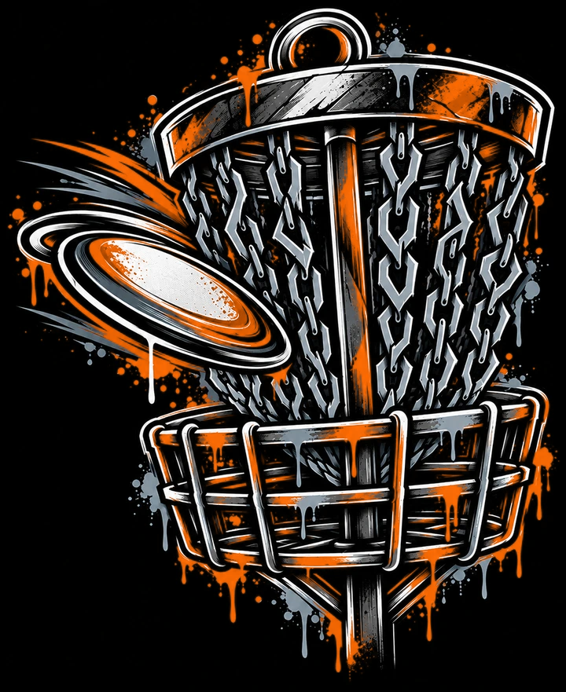

<div align="center">



# ChainLink

**Your round. Your score. Your game.**

Offline-first disc golf scorekeeping for Android.

[](https://github.com/Tannman129/ChainLink-Public/releases)
[](https://github.com/Tannman129/ChainLink-Public/releases/tag/v0.1.0-beta.1)

### [⬇ DOWNLOAD THE ANDROID BETA](https://github.com/Tannman129/ChainLink-Public/releases/tag/v0.1.0-beta.1)

*Free early-access build · No account needed to keep score offline*

</div>

---

## Built for the course

ChainLink is a focused scorekeeper: get into a round quickly, track strokes, and get back to throwing. The Android app works offline, including course editing and scorekeeping.

| **Keep score** | **Manage courses** | **Pick up where you left off** |
|:---|:---|:---|
| Track strokes hole by hole, navigate holes, and review your scorecard. | Create and edit courses; keep favorites ready for fast selection. | Resume an unfinished round and review completed rounds in history. |

### In the current beta

- **Offline scoring** — round and scorekeeping flows work without an internet connection.
- **Course management** — create, edit, find, and favorite saved courses.
- **Tee and basket options** — select configured tee/basket choices when available.
- **Round history** — finish a round and review saved results.
- **Dark, high-contrast interface** — ChainLink's signature orange-and-black design.

## Install on Android

1. Open the [latest available release](https://github.com/Tannman129/ChainLink-Public/releases) on your Android phone.
2. Under **Assets**, download the `.apk` file. For the first beta it is named `app-release.apk`.
3. Open the downloaded file and, if Android prompts you, allow installation from that source.
4. Open **ChainLink** and start a round.

**Requirements:** Android 8.0 (API 26) or newer. This is a prerelease distributed outside the Play Store.

> [!IMPORTANT]
> **Your data currently lives on your phone.** Server synchronization, account recovery, and remote backups are **not available in this beta**. Uninstalling ChainLink or clearing app storage deletes locally saved courses and rounds. Future updates signed with the same release key are intended to preserve app data, but backups are not yet supported.

## Check your download

The SHA-256 hash of the **v0.1.0-beta.1** APK is:

```text
dc7c271b1c4837e85607265fa15fc51478b2225dee424c6bf28b8405f0ba08cc
```

The official download comes from [this repository's Releases page](https://github.com/Tannman129/ChainLink-Public/releases). Avoid APKs from unofficial mirrors.

## What's next

ChainLink is being developed with an optional self-hosted backend in mind: course management through a browser and eventual two-way synchronization. **These features are in development, not part of the current Android beta.**

## Beta feedback

Found a crash or something that doesn't behave correctly? [Open an issue](https://github.com/Tannman129/ChainLink-Public/issues) and include your phone model, Android version, app version, and steps to reproduce it. Please don't post private account information or personal data.

---

<div align="center">

**ChainLink** · Made for disc golf. Designed to keep you playing.

[**Download**](https://github.com/Tannman129/ChainLink-Public/releases) · [**Report a bug**](https://github.com/Tannman129/ChainLink-Public/issues)

</div>
